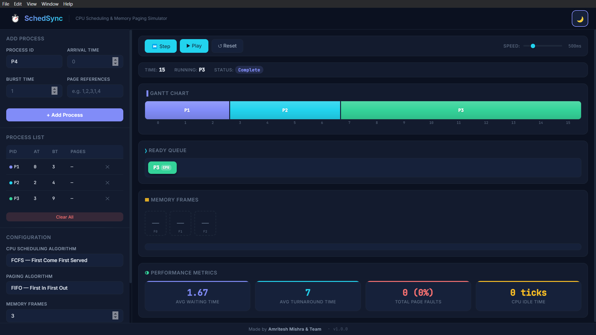
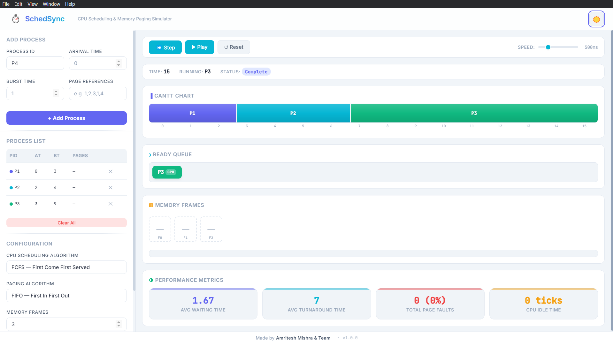

# ⏱ SchedSync — CPU Scheduling & Memory Paging Simulator

<p align="center">
  <strong>A desktop simulator that integrates CPU scheduling and memory paging to visualize their combined performance impact — step by step.</strong>
</p>

<p align="center">
  
  
  
  
  
</p>

---

## 📸 Screenshots

<p align="center">
  
</p>
<p align="center"><em>Dark Mode — Gantt chart, ready queue, memory frames, and performance metrics</em></p>

<br />

<p align="center">
  
</p>
<p align="center"><em>Light Mode — Clean and modern interface with theme toggle</em></p>

---

## 📖 About

Modern operating systems do not execute CPU scheduling and memory management in isolation. The performance of a process depends not only on how CPU time is allocated, but also on how efficiently memory pages are managed. **Page faults can stall CPU execution**, increase waiting time, and reduce overall system efficiency.

**SchedSync** is an educational desktop application that simulates this interaction, providing **step-by-step visual execution** to help students and developers understand how CPU scheduling and memory paging work together.

---

## ✨ Features

### CPU Scheduling Algorithms
| Algorithm | Type | Description |
|-----------|------|-------------|
| **FCFS** | Non-preemptive | First Come First Served — processes execute in arrival order |
| **SJF** | Non-preemptive | Shortest Job First — selects the shortest burst time when CPU is free |
| **SRTF** | Preemptive | Shortest Remaining Time First — preempts if a shorter job arrives |
| **Round Robin** | Preemptive | Circular queue with configurable time quantum |
| **Priority** | Non-preemptive | Lower number = higher priority; ties broken by arrival time |

### Memory Paging Algorithms
| Algorithm | Description |
|-----------|-------------|
| **FIFO** | First In First Out — evicts the oldest page in memory |
| **LRU** | Least Recently Used — evicts the page unused for the longest time |

### Real-Time Visualizations
- 📊 **Gantt Chart** — Color-coded, auto-scrolling horizontal timeline with stall indicators
- 📋 **Ready Queue** — Live display of running process (CPU badge) and waiting queue
- 🧩 **Memory Frames** — Frame grid with green pulse on hits, red shake on faults
- 📝 **Page Access Log** — Scrolling log with ✓ hits and ✗ faults

### Simulation Controls
- ⏭ **Step** — Advance one time unit at a time
- ▶ **Play / Pause** — Auto-run at adjustable speed (100ms–2000ms)
- ↺ **Reset** — Clear and restart the simulation

### Performance Metrics
- **Avg Waiting Time** — Mean time processes spend in the ready queue
- **Avg Turnaround Time** — Mean time from arrival to completion
- **Total Page Faults** — With fault rate percentage
- **CPU Idle Time** — Total ticks when no process was executing

### Extras
- 🌗 **Dark & Light Mode** — Toggle between themes with smooth transitions
- 🎨 **Premium UI** — Glassmorphism header, gradient accents, micro-animations

---

## 🖥 CPU–Memory Interaction

SchedSync simulates the real-world interaction between CPU scheduling and memory paging:

```
Process runs on CPU → Accesses a page → Hit or Fault?
                                            │
                   ┌────────────────────────┤
                   │                        │
                 HIT ✓                   FAULT ✗
            Continue execution     CPU stalls for N ticks
                                   (configurable stall time)
                                   Page loaded into memory
                                   (may evict oldest/LRU page)
```

> **Page fault stalls** directly affect Avg Waiting Time and Turnaround Time — experiment with different frame counts and stall times to see the impact!

---

## 🚀 Getting Started

### Prerequisites
- [Node.js](https://nodejs.org/) v18 or later
- npm (bundled with Node.js)

### Installation

```bash
# Clone the repository
git clone https://github.com/AMRITESH-MISHRA-15/SchedSync.git
cd SchedSync

# Install dependencies
npm install

# Launch the application
npm start
```

---

## 📝 How to Use

1. **Add Processes** — Enter Process ID, Arrival Time, Burst Time, and optional Page Reference String
2. **Configure** — Select CPU scheduling algorithm, paging algorithm, memory frames (1–10), and page fault stall time (0–5)
3. **Step or Play** — Click **Step** to advance one tick, or **Play** to auto-run
4. **Observe** — Watch the Gantt chart build, ready queue update, and memory frames change in real time
5. **Analyze** — Review the performance metrics after simulation completes
6. **Experiment** — Reset and try different algorithm combinations to compare performance

---

## 🏗 Tech Stack

| Technology | Purpose |
|------------|---------|
| **Electron.js** | Desktop application framework |
| **HTML5** | Structure and semantic layout |
| **CSS3** | Design system with custom properties, animations |
| **Vanilla JavaScript** | All application logic, algorithms, and visualizations |

---

## 📂 Project Structure

```
SchedSync/
├── main.js                          # Electron main process
├── preload.js                       # Preload script (IPC security bridge)
├── package.json                     # Dependencies and scripts
├── LICENSE                          # MIT License
├── README.md
├── assets/
│   ├── icons/                       # App icons
│   └── screenshots/                 # README screenshots
└── src/
    ├── index.html                   # Main renderer page
    ├── styles/
    │   ├── variables.css            # Design tokens (light & dark themes)
    │   ├── base.css                 # Reset, typography, layout grid
    │   ├── header.css               # Glassmorphism header, logo, theme toggle
    │   ├── footer.css               # Compact footer
    │   ├── input-panel.css          # Sidebar form, table, config selectors
    │   └── visualization.css        # Gantt, ready queue, memory, metrics, controls
    └── js/
        ├── theme.js                 # Dark/light mode toggle with persistence
        ├── process-manager.js       # Add/remove/validate processes
        ├── app.js                   # Entry point, form handling, toast system
        ├── controls.js              # Play/Pause/Step/Reset, speed control
        ├── simulation-engine.js     # Core orchestrator (CPU + paging + stalls)
        ├── algorithms/
        │   ├── fcfs.js              # First Come First Served
        │   ├── sjf.js               # Shortest Job First
        │   ├── srtf.js              # Shortest Remaining Time First
        │   ├── round-robin.js       # Round Robin with time quantum
        │   ├── priority.js          # Priority scheduling (non-preemptive)
        │   ├── fifo-paging.js       # FIFO page replacement
        │   └── lru-paging.js        # LRU page replacement
        └── visualization/
            ├── gantt-chart.js       # Incremental Gantt chart renderer
            ├── ready-queue.js       # Ready queue with CPU badge
            └── memory-frames.js     # Memory frame grid + page log
```

---

## 👥 Team

<p align="center">
  <strong>Made by Amritesh Mishra & Team</strong>
</p>

---

## 📄 License

This project is licensed under the **MIT License** — see the [LICENSE](LICENSE) file for details.
